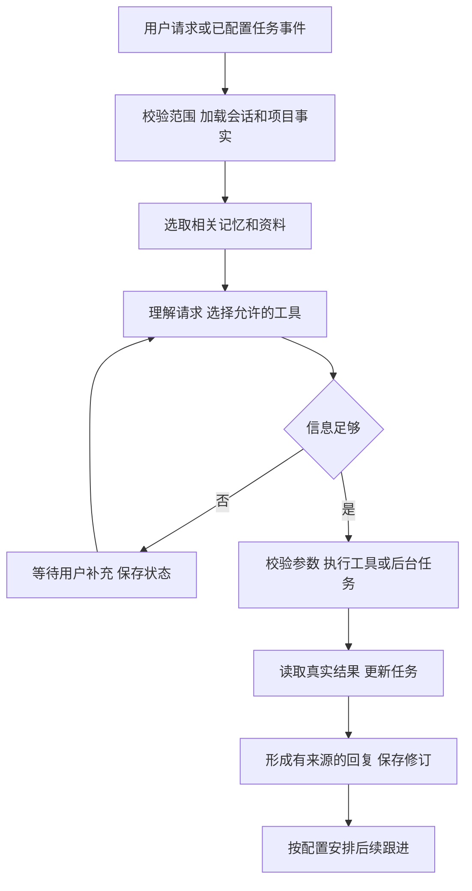

**ResearchMate（研伴）：科研项目协作 Agent**

**当前开发入口：[每天约8小时的七天开发清单](./7天开发清单/README.md)**。包含每日前后端任务、LovAgent 源码对照、Git/GitHub 操作、Docker 部署与20项系统验收；由你亲手实现七天 v0.1。下文保留完整产品与后续扩展设计。

**今天开始：[Day 1 逐步实操](./7天开发清单/Day01-逐步实操.md)**，需要代码参照时看 [Day 1 最小示例](./7天开发清单/Day01-最小代码示例.md)。

设计日期：2026-10-20。定位：服务机器学习研究生和个人研发者，持续记住一个项目的背景、比较实验结果、执行受控工具，并按配置跟进任务。

当前状态：业务方案与开发任务已落地；附带一个可运行的 CSV 实验比较工具。聊天界面、LLM Agent、数据库、队列、提醒和 MCP 均尚未实现。示例数据完全为合成数据，数值不属于用户研究成果。

**1．为什么这个方向适合你**

依据当前工作区记录：你了解 Python，已有 PyTorch 推理代码与权重，研究涉及多变量时序建模和矿物组分估计，希望学习完整 Agent 工作链路与 Git/PR/CI/部署。

这个项目把你每天能接触的数据、实验结果和项目背景变成真实素材。第一使用者是你本人，是否解决问题可通过日常使用验证。现有研究模型作为后续工具接入，主流程持续支持交流、记录、查询、执行与跟进。

首个业务场景限定为“实验复盘与下一步跟进”。检索论文、撰写论文、自动改代码、自动训练、团队权限和外部通知暂留后续范围。项目价值假设尚未经过企业访谈或真实效率测量。

**2．一句具体的使用请求**

> 我在准备本周组会。帮我比较这个项目的 baseline 和 candidate 实验，记住我报告结果时先看 RMSE。把需要补充的验证记成待办，明天 9 点在站内提醒我检查进展。

系统需要先确认项目与实验对应关系，使用实际数据比较，分别保存偏好与任务，再在明确时刻产生可追溯提醒。组会日期缺失时应追问，不凭“本周”自行创建截止时间。

不同对话入口还可以处理：

- “接着昨天那个消融实验，我们做到哪了？”——加载项目事实、任务和相关记忆。
- “那一组比 baseline 改善多少？”——有歧义时先定位 run ID，指标由程序计算。
- “补一个跨随机种子的实验计划。”——生成带状态的计划草稿，未运行的实验标为未执行。
- “结果出来了，帮我更新进展。”——登记新结果，关联原任务，保留旧版本。
- “今天先不提醒了，改成后天上午十点。”——更新指定提醒，旧版本后续不再触发。

这些是目标行为，尚不是已运行演示。

**3．第一版的完整业务故事**

1. 创建项目 P001，录入目标、数据范围、基线和已有实验。
2. 上传经过显式映射的实验结果 CSV，保存为不可变数据版本。
3. 用户提问；Agent 解析任务与指代，加载必要上下文。
4. 调用比较工具，核查项目、数据版本、划分、评估协议、指标、单位和随机种子。
5. 返回比较结果，注明源文件、run ID 和来源行。条件不一致时解释哪些字段不同。
6. 用户可把后续验证要求登记为任务；真实执行与计划条目分别保存。
7. 用户配置提醒后，到期生成站内消息；若任务已完成或取消，按配置停止相应跟进。
8. 次日新会话仍能查询项目状态，修改偏好或纠正事实。

成功标准：隔天回来，可以正确接续项目，并从回答定位到真实任务与实验记录。

**4．借鉴 LovAgent 的方式**

| LovAgent 的需求 | ResearchMate 的对应设计 |
|---|---|
| 稳定角色 | 稳定的研发协作角色与输出偏好 |
| 聊天上下文 | 当前讨论的项目、实验和任务引用 |
| 用户长期记忆 | 用户偏好与项目背景，保留来源及修订 |
| 情绪回应 | 按用户时间、目标与进度调整信息量；首版不实现情绪评分 |
| 主动问候 | 明确到期任务、运行完成和约定检查点触发跟进 |
| 联网搜索 | 先检索项目内方法文档；公开检索后续再接 |
| 消息交付 | 首版站内通知，有状态、事件 ID 和重复处理记录 |

业务角色提示词可以是：“你帮助用户持续推进已登记的研发项目。优先查询项目事实和工具结果；缺少实验数据时明确说明。建议、计划、已执行结果分别表达。”

Prompt 是行为指导，项目范围、参数校验、数据写入和结果状态由程序约束。

**5．第一版模块与页面**

| 模块 | 必须实现的行为 |
|---|---|
| 项目对话 | 选定项目、多轮指代、SSE 展示工具与状态、跨重启恢复 |
| 记忆 | 保存偏好与有来源的背景，可查看、修订、删除 |
| 实验结果 | 登记 CSV、比较同口径结果、返回来源 |
| 任务 | 草稿、待补充、排队、执行、成功、失败、取消等状态按用途区分 |
| 提醒 | Asia/Shanghai 时区、到期执行、修改/取消、交付记录 |
| 运行记录 | 请求 → graph run → tool call → task → result 的关联 |

页面采用一个工作台：左侧项目列表，中间对话，右侧显示当前任务、关联结果与待确认信息。结果详情和记忆编辑从右侧打开，首版不建复杂门户。

前端可以展示用户能理解的“正在读取结果”“需要补充评估协议”；内部堆栈和框架细节放入开发 trace。

**6．Agent 的执行结构**



模型负责理解自然语言、选择允许的工具、整理有依据的说明。程序负责比较计算、任务状态、幂等、范围检查和交付。

建议第一版限制每次请求最多 6 次工具调用；可重试的暂时性错误最多重试 2 次。这些是应用设计值，需要实测后调整。明确的输入错误、口径不一致与不兼容模型直接返回可解释结果。

**7．四种数据必须分清**

| 类型 | 例子 | 存放与修改原则 |
|---|---|---|
| 会话状态 | “那一组”当前指向 R002 | graph checkpoint，可恢复 |
| 偏好记忆 | 喜欢简洁回答、优先看 RMSE | 跨会话存储，可纠正与删除 |
| 项目事实 | 数据版本、评估划分、模型适用范围 | 独立业务表、来源与版本，不由摘要覆盖 |
| 执行结果 | 某次工具输出、任务成功或失败 | 由真实执行产生，关联任务与输入版本 |

模型提出的原因解释属于假设或建议，不能自动写入“实验已证明的结论”。

LangGraph 官方把 thread 内状态的 checkpointer 与跨 thread 的 store 分开；这里继续把实验与任务事实维护为独立业务记录。[持久化文档](https://docs.langchain.com/oss/python/langgraph/persistence)

**8．技术路线与引入顺序**

完整技术目标包括持续对话、记忆、工具/MCP、任务恢复、检索、研究服务与工程交付；七天 v0.1 的具体范围和后续扩展以 [七天开发清单](./7天开发清单/README.md) 为执行入口。依赖按实施时稳定版本验证与锁定。

| 阶段 | 组件 | 实际用途 |
|---|---|---|
| 起步 | Python、uv、标准化 CSV、pytest/Ruff | 先验证比较工具、输入契约与错误行为 |
| 对话闭环 | FastAPI、Pydantic、LangGraph、PostgreSQL、SQLAlchemy/Alembic | 对话、工具调用、checkpoint、记忆和事实 |
| 页面与跟进 | React/TS/Vite、SSE、Celery/Redis | 工作台、后台任务、到期扫描、站内通知 |
| 扩展 | pgvector、MCP SDK、独立 PyTorch 服务 | 项目资料检索和专业工具 |
| 交付 | Langfuse、Playwright、Docker Compose、GitHub Actions | trace、关键行为回归与复现 |

实施时先核对官方当前稳定版本和兼容性，再生成 uv/pnpm 锁文件；本目录尚未完成这项初始化，不预填未经安装验证的版本号。

你当前 Windows 环境能找到 Python、Node、Git、pnpm 和 Docker CLI；本次未找到 uv 命令，Docker Linux engine 未启动。因此后续环境关卡先补齐 uv、启动 Docker Desktop 并验证 Linux 容器。Celery worker 在 Linux 容器或 WSL2 中运行，官方当前不支持原生 Windows。[Celery FAQ](https://docs.celeryq.dev/en/stable/faq.html)

研究模型继续使用其已验证的环境，通过独立服务接入。

**9．第一版与后续范围**

第一版围绕：一个本地用户、两个项目用于检查串项目问题、一种规范化 CSV、一个指标比较工具、偏好记忆、任务和站内提醒。单用户演示不宣称实现生产鉴权或团队权限；project_id 是业务范围字段，不能代替身份认证。

专业扩展先选择一个你确实能运行的模型。GRAIL 工具只接受其已验证数据域、频率、变量、预处理与窗口；矿物模型使用自己的输入输出契约。文件同为 CSV，不代表模型可互换。

后续再加入项目方法文档检索、MCP 实际 server/client 调用、一个研究模型服务，以及固定评测集和部署流程。首版不要求接完所有研究。

**10．你自己的贡献应怎样形成**

- 研发项目的任务、实验与事实数据模型。
- 可纠正、可追溯的项目记忆。
- 实验可比性检查与有来源的数值结果。
- 带状态、重复处理和恢复测试的任务跟进。
- 已有研究模型的工程适配与推理一致性验证。
- 固定案例下的工具正确性、记忆使用、恢复行为与实际开销。

这些能力完成并实测后，才进入简历。当前研究精度不能直接当成本应用的效果指标。

**11．目录入口**

- [工具与状态契约](./工具与状态契约.md)
- [七个开发关卡](./开发关卡.md)
- [合成实验结果](./examples/runs_demo.csv)
- [首个可运行工具](./tools/compare_runs.py)
- [工具测试](./tests/test_compare_runs.py)
- [起步工具验证记录](./验证记录.md)
- [待执行的 Agent 验收案例](./evals/scenarios.json)

在本目录运行首个工具：

```powershell
python -X utf8 -m tools.compare_runs --csv examples/runs_demo.csv --project P001 --baseline R001 --candidate R002
python -X utf8 -m unittest discover -s tests -v
```

成功用例会给出合成数据中 RMSE 从 0.50 到 0.45、改善 10% 的计算结果与来源行；这只演示工具算法。将 candidate 改为 R003 会因划分与协议不同而拒绝比较，命令退出码为 2。

